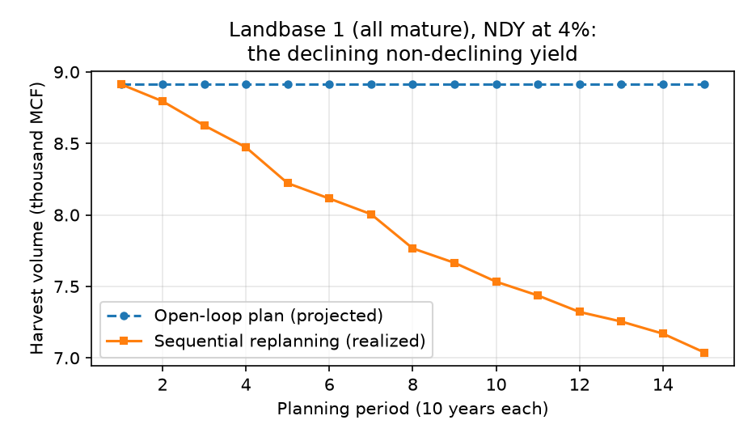

# 02 — Core experiment grid (thesis reproduction)

432 cells: 18 landbases x 4 constant discount rates (0/2/4/6%) x 6
harvest-flow policies (Table 5.6: NHF, NDY, -10%, -20%, +/-10%, +/-20%),
each a full sequential-replanning simulation over the 15-period horizon.
Per-cell records: [grid.csv](../results/experiments/grid.csv) and
[grid_trajectories.csv](../results/experiments/grid_trajectories.csv).

## Headline

Basis: the thesis's observation window, periods 2-11 (thesis p. 83); periods
1-15 are the sensitivity. Both windows are tabulated below.

- Flow-constrained cells: **49%** exhibit dynamic
  inconsistency over periods 2-11 (mean relative divergence > 5%;
  56% over periods 1-15).
- Flow-unconstrained (NHF) control: **47%**; by
  discount rate 0%: 18/18, 2%: 16/18, 4%: 0/18, 6%: 0/18. Under a fixed horizon the control's
  divergence falls to 0/72 (a rolling-horizon effect; see
  [03](03-gap-diagnostic.md) and [10](10-review-analyses.md)).

## The declining non-declining yield

## Occurrence and magnitude by harvest-flow policy

| flow_policy | occ_2_11 | mag_2_11 | occ_1_15 | mag_1_15 |
| --- | --- | --- | --- | --- |
| +/-10% | 0.472 | 0.062 | 0.514 | 0.079 |
| +/-20% | 0.556 | 0.077 | 0.639 | 0.1 |
| -10% | 0.361 | 0.063 | 0.375 | 0.076 |
| -20% | 0.389 | 0.08 | 0.431 | 0.098 |
| NDY | 0.694 | 0.077 | 0.861 | 0.087 |
| NHF | 0.472 | 0.168 | 0.472 | 0.171 |

Flow-constrained policies only:

| flow_policy | occ_2_11 | mag_2_11 | occ_1_15 | mag_1_15 |
| --- | --- | --- | --- | --- |
| +/-10% | 0.472 | 0.062 | 0.514 | 0.079 |
| +/-20% | 0.556 | 0.077 | 0.639 | 0.1 |
| -10% | 0.361 | 0.063 | 0.375 | 0.076 |
| -20% | 0.389 | 0.08 | 0.431 | 0.098 |
| NDY | 0.694 | 0.077 | 0.861 | 0.087 |

## Occurrence and magnitude by discount rate (flow-constrained)

| discount_rate | occ_2_11 | mag_2_11 | occ_1_15 | mag_1_15 |
| --- | --- | --- | --- | --- |
| 0.0 | 1.0 | 0.161 | 1.0 | 0.192 |
| 0.02 | 0.289 | 0.043 | 0.478 | 0.054 |
| 0.04 | 0.311 | 0.038 | 0.356 | 0.048 |
| 0.06 | 0.378 | 0.045 | 0.422 | 0.058 |
