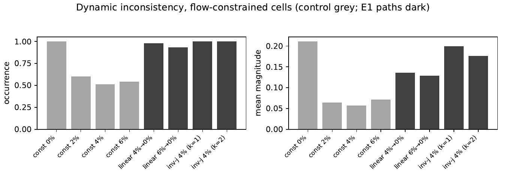
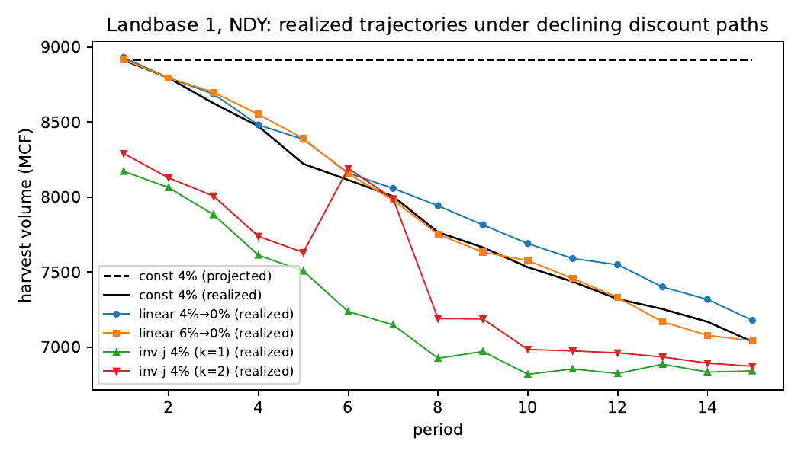

# 05 — E1: Time-varying discount-rate shapes

Does a *declining* discount rate mitigate or eliminate dynamic
inconsistency? Paths: linear 4%->0%, linear 6%->0%, inverse-j 4% (hold 1 or
2 periods, then halve per period). Grid: 432 cells (4 paths x 18 landbases x
6 policies), each with the gap diagnostic. Records:
[summary](../results/experiments/grid_discount_paths.csv) /
[trajectories](../results/experiments/grid_discount_paths_trajectories.csv) /
[gaps](../results/experiments/grid_discount_paths_gaps.csv).
Analysis writeup: [p9 writeup](../results/analysis/p9_discount_shapes/writeup.md).

## Headline

Basis: periods 2-11 (thesis p. 83); the table also carries periods 1-15.

Declining rates make inconsistency MORE pervasive, not less: flow-constrained
occurrence is 75% across the E1 paths over
periods 2-11, with mean magnitude
0.14 (constant-rate control, by
rate: 0%: 0.16, 2%: 0.04, 4%: 0.04, 6%: 0.05); over periods 1-15 it is 95%, mean
magnitude 0.17. The flow-unconstrained
control under declining paths diverges at 100%
occurrence, consistent with the preference-level (Strotz) channel of
re-applying a declining schedule from each planner's present, but not separated
here from the low-rate rolling-horizon effect (the control at a constant 0%
rate: 100%).

## Occurrence and magnitude by path (flow-constrained cells)

| discount_path | occ_2_11 | mag_2_11 | occ_1_15 | mag_1_15 |
| --- | --- | --- | --- | --- |
| invj-4pc-k1 | 1.0 | 0.207 | 1.0 | 0.224 |
| invj-4pc-k2 | 0.989 | 0.234 | 1.0 | 0.253 |
| linear-4pc-0pc | 0.611 | 0.059 | 0.9 | 0.103 |
| linear-6pc-0pc | 0.389 | 0.053 | 0.9 | 0.091 |
