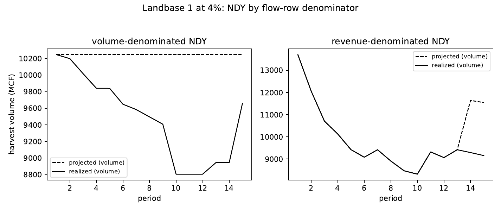

# 07 — E3: Value-denominated flow constraints

Does denominating the bounded-deviation flow constraint in undiscounted net
revenue (instead of volume) mitigate or eliminate inconsistency? Grid: 864
cells (18 landbases x 4 rates x 6 policies x 2 denominators), each with the
gap diagnostic and dual volume+revenue trajectory records. Records:
[summary](../results/experiments/grid_value_flow.csv) /
[trajectories](../results/experiments/grid_value_flow_trajectories.csv) /
[gaps](../results/experiments/grid_value_flow_gaps.csv).
Analysis writeup: [p11 writeup](../results/analysis/p11_value_flow/writeup.md).

> Correction (P14, issue #75): the E3 records were regenerated after a defect
> that announced the volume-denominated plan in revenue-denominated cells; the
> earlier conclusion (revenue denominating worsens inconsistency) is reversed.

## Headline

Basis: periods 2-11 (thesis p. 83); the table also carries periods 1-15.

Revenue denominating does not mitigate inconsistency over the headline window:
flow-constrained occurrence 171/360
(48%, revenue) vs
178/360
(49%, volume); mean magnitude
0.081 vs
0.072. Over periods 1-15 the
occurrence is 181/360 vs
203/360, a modest reduction. The effect
differs by policy form (table below): NDY and bounded decline fall sharply,
symmetric bounded deviation rises slightly. The revenue floor does not keep
CM-CE out of the plan: on landbase 1 the revenue-denominated NDY plan harvests
2.2%-3.2% CM-CE (vs 0.0%-5.3%
of projected volume under volume NDY), confined to the first period, where it
lowers the non-declining revenue anchor; the channel narrows rather than
closes. On the paired landbases (with vs without CM-CE) the extra inconsistency
associated with negatively valued strata shrinks but does not disappear, and
inconsistency persists through the remaining strata. See the writeup's Table T4
and paired-landbase table.

## Occurrence and magnitude by denominator and policy (flow-constrained)

| flow_denominator | flow_policy | occ_2_11 | mag_2_11 | occ_1_15 | mag_1_15 |
| --- | --- | --- | --- | --- | --- |
| revenue | +/-10% | 0.5 | 0.077 | 0.5 | 0.09 |
| revenue | +/-20% | 0.819 | 0.116 | 0.875 | 0.131 |
| revenue | -10% | 0.306 | 0.066 | 0.333 | 0.078 |
| revenue | -20% | 0.403 | 0.079 | 0.444 | 0.093 |
| revenue | NDY | 0.347 | 0.07 | 0.361 | 0.073 |
| volume | +/-10% | 0.472 | 0.062 | 0.514 | 0.079 |
| volume | +/-20% | 0.556 | 0.077 | 0.639 | 0.1 |
| volume | -10% | 0.361 | 0.063 | 0.375 | 0.076 |
| volume | -20% | 0.389 | 0.08 | 0.431 | 0.098 |
| volume | NDY | 0.694 | 0.077 | 0.861 | 0.087 |
