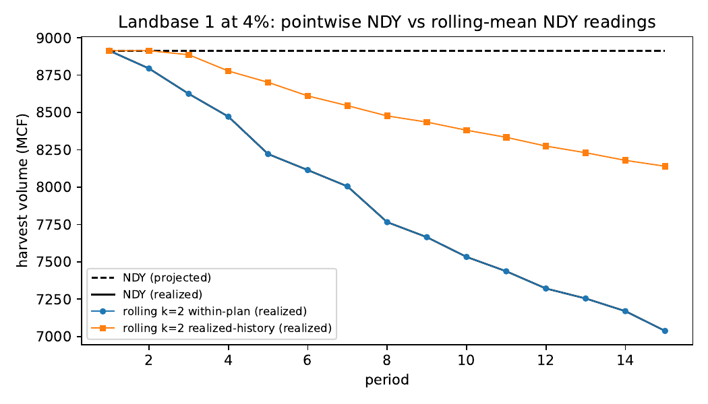

# 08 — E4: Rolling-mean NDY

Does flooring each period's harvest at the backwards-facing rolling 2- or
3-period mean (instead of the previous period's level) change inconsistency?
Grid: 288 cells (18 landbases x 4 rates x windows {2, 3} x both anchoring
readings). Records: [summary](../results/experiments/grid_rolling_mean.csv) /
[trajectories](../results/experiments/grid_rolling_mean_trajectories.csv) /
[gaps](../results/experiments/grid_rolling_mean_gaps.csv).
Analysis writeup: [p12 writeup](../results/analysis/p12_rolling_mean/writeup.md).

## Headline

Basis: periods 2-11 (thesis p. 83); the table also carries periods 1-15.

Constraint SHAPE is not the operative margin: within-plan rolling-mean
occurrence 69% vs pointwise NDY (69%) over
periods 2-11 (1-15: 85% vs 86%). The
ANCHORING INSTITUTION is: realized-history anchoring mitigates (occurrence
27%, magnitude
0.046; 1-15: 45%)
but the floor cannot be held exactly in 65% of replans, where
it is loosened minimally (median 1.3%, maximum
2.3% of the floor; dropped in 0 replans) — the declining-NDY mechanism
as small, persistent shortfalls.

## By anchoring reading and window

| anchoring | flow_window | occ_2_11 | mag_2_11 | occ_1_15 | mag_1_15 | relax_share |
| --- | --- | --- | --- | --- | --- | --- |
| realized-history | 2 | 0.278 | 0.046 | 0.472 | 0.053 | 0.683 |
| realized-history | 3 | 0.264 | 0.046 | 0.431 | 0.054 | 0.674 |
| within-plan | 2 | 0.681 | 0.083 | 0.847 | 0.091 | 0.0 |
| within-plan | 3 | 0.694 | 0.083 | 0.861 | 0.09 | 0.0 |
